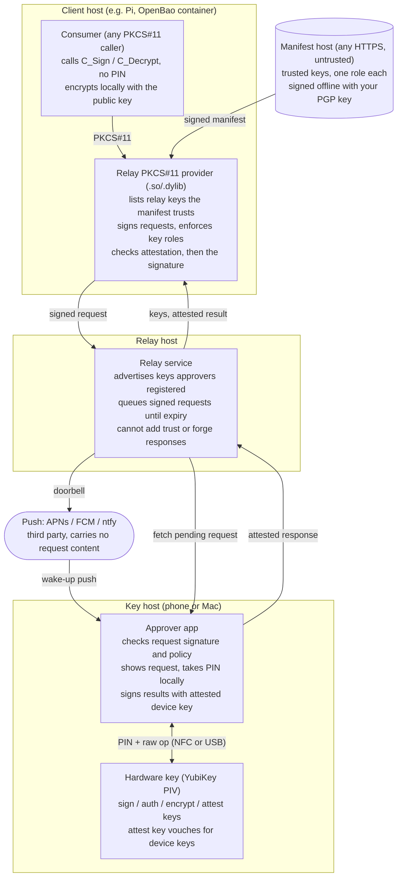
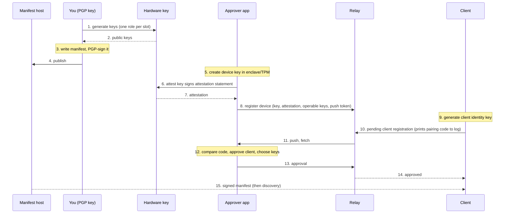
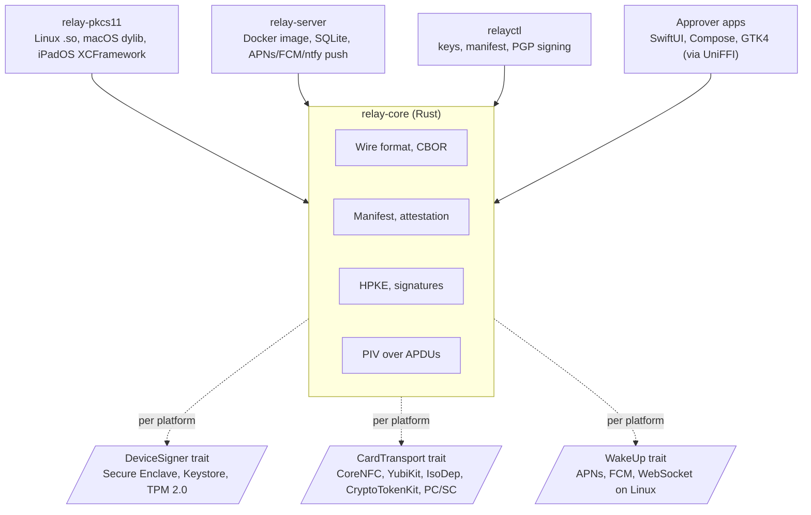

# Approval-Gated PKCS#11 Relay — Architecture

Exported from the design doc on 2026-11-15. Diagrams are Mermaid versions of the doc's drawings. Updated 2026-11-15 with the departures Brian approved during milestones 1–3; each is recorded in `docs/decisions.md`, and the byte-level formats are in `docs/wire-format.md`.

A PKCS#11 provider that holds no private keys forwards each sign or decrypt to a relay. An approver app on the device holding the hardware key shows the request, collects the PIN locally, runs the operation on the key and returns the result sealed to the requester. Trust never comes from the relay: clients use only keys that a manifest signed by your PGP key lists, each for its one role. They accept only responses signed by a device key that a manifest-listed attest key vouched for within its validity window.

## At a glance



Arrows show where data goes, not who connects: the provider and the app both open connections out to the relay. The manifest host and the relay are both untrusted. Clients believe a key only because your PGP key signed the manifest, and a response only because a manifest-listed attest key vouched for the device that signed it.

## Key discovery

The relay answers discovery, but the manifest decides trust: the provider exposes a key only if both list it, and everything security-relevant about the key comes from the manifest.

```mermaid
sequenceDiagram
  participant C as Consumer
  participant P as Provider
  participant M as Manifest host
  participant R as Relay
  C->>P: 1. C_FindObjects (or C_GetSlotList)
  P->>M: 2. GET manifest (only if cache stale)
  M-->>P: 3. manifest + PGP signature
  Note over P: 4. check PGP signature, version, expiry
  P->>R: 5. GET /v1/keys (only if cache stale)
  R-->>P: 6. advertised keys
  Note over P: 7. keep keys in both lists;<br/>role, label, ID come from the manifest
  P-->>C: 8. slots and objects
```

Steps 2 and 3, and 5 and 6, are skipped while the cached copies are fresh.

- **Match by fingerprint.** The fingerprint is the SHA-256 of the key's SubjectPublicKeyInfo. The provider recomputes it from the public key the relay sends; a fingerprint supplied by the relay is never trusted.
- **Role, label, `CKA_ID` and token grouping come from the manifest.** If the relay could set labels, it could swap two trusted keys under the label a consumer looks up, such as OpenBao's `key_label`.
- **One role per key.** The provider exposes and permits each key only for the role the manifest gives it (table below). A key the relay advertises under a different role is still used only for its manifest role.
- **Advertised means registered, not online.** A key stays listed while its approver's phone is asleep; an operation on it then waits for approval or times out.
- **Cache both lists.** Keep the manifest until its `valid_until` and the relay's list for a short time (for example 5 minutes), so a restart during an outage still finds its keys.

| Role | Exposed to consumers as | Allowed |
| --- | --- | --- |
| `sign` | Private key with `CKA_SIGN` | `C_Sign` with hash-and-sign mechanisms; the approver sees and decodes the message |
| `auth` | Private key with `CKA_SIGN` | `C_Sign` over opaque challenges, such as SSH or TLS client authentication |
| `encrypt` | RSA: private key with `CKA_DECRYPT`, public key with `CKA_ENCRYPT`. P-256, P-384, X25519: private key with `CKA_DERIVE` | RSA: `C_Decrypt`, with encryption in software using the public key. EC: `C_DeriveKey` (ECDH), where the consumer encrypts by agreeing a key with the public key |
| `attest` | Not exposed | Only verifying device attestation statements |

## Operation flow

```mermaid
sequenceDiagram
  participant C as Consumer
  participant P as Provider
  participant R as Relay
  participant A as Approver app
  participant K as Hardware key
  C->>P: 1. C_Decrypt
  Note over P: 2. sign request, new one-time reply key
  P->>R: 3. POST request
  Note over R: 4. check client, queue, ring
  R->>A: 5. push (no content)
  A->>R: 6. fetch pending
  R-->>A: 7. signed request
  Note over A: 8. verify, show; user approves
  A->>K: 9. VERIFY PIN
  A->>K: 10. raw RSA op
  K-->>A: 11. raw result
  Note over A: 12. OAEP-decode, seal to reply key, device-sign
  A->>R: 13. POST signed response (+ attestation)
  R-->>P: 14. attested response
  Note over P: 15. check attestation + signature, open, zero reply key
  P-->>C: 16. plaintext, CKR_OK
```

Discovery has already run. The provider blocks from step 3 until step 14 or its deadline. Step 8 is the only point where a person acts, and steps 9 to 12 happen entirely on the key host. In step 15 the provider checks the attestation, then the device signature, before it opens the result. Dashed arrows are responses; a signature request follows the same path with the message in place of ciphertext.

## Enrollment



Enrollment has three independent parts: publishing keys in the manifest, enrolling approver devices, and pairing clients. Only publishing needs your PGP key, and no step relies on the relay to vouch for anything. You, the operator, do each part once, and again only when a key, device or client is added, renewed or removed.

**Publishing keys (steps 1 to 4).** Generate keys on the YubiKey, one role per slot. Add each public key's fingerprint, role, label and token to the manifest, increase its version, sign it with your PGP key and publish it. Removing a key works the same way: publish a new version without it.

**Enrolling an approver (steps 5 to 8).** The app creates a non-exportable response-signing key in the Secure Enclave, Android Keystore or a TPM. You set the device's attestation window at enrollment, for example 30 days. The YubiKey's attest key signs an attestation statement binding the device key's fingerprint to that window (Keys and messages, below). The app then registers its device key, attestation and the hardware keys it can operate with the relay; that registration is what the relay advertises.

**Renewing attestations.** When three quarters of the window has passed, the app gets a new statement during the next approval that already has the YubiKey present: one extra card operation, no extra tap. If the attest key lives on a separate offline YubiKey, renewal is a periodic ceremony instead. An expired device can still fetch requests, but every client rejects its responses until it is renewed.

**Pairing a client (steps 9 to 15).** Headless clients need no input:

1. Configure the client with the relay URL, the manifest URL and your PGP public key. All three are public and the same for every client, so bake them into the image or a mounted config file.
2. On first start, the client generates its identity key, posts a pending registration to the relay, and prints a pairing code derived from its key's fingerprint to its log: four words from the EFF large wordlist (about 51.7 bits; at least 50 bits is required).
3. In the app, open the pending clients, compare the code with the client's log (`docker logs`, or over SSH), then approve, choosing which keys the client may use.
4. The client fetches and verifies the manifest, then runs discovery.

**Order no longer matters.** Clients trust only your PGP key, so they can be deployed before any approver exists. Their keys appear once the manifest lists them and an enrolled approver advertises them.

The relay accepts pending client registrations only from the tailnet, holds at most a few at a time, and drops them after 10 minutes. A pending client can do nothing until it is approved, so abusing the registration endpoint gets an attacker nothing but a notification you deny.

Put the client key and the last verified manifest on a persistent volume, so restarts and image rebuilds need neither a new pairing nor a reachable manifest host.

## PKCS#11 provider

The provider holds no private keys and no key list of its own. It builds its slots from the relay's advertisement filtered through the signed manifest, turns each `C_Sign` / `C_Decrypt` into a signed request, and returns a result only after verifying the device attestation and signature that come with it.

**Runs:** inside the requesting process as a shared library (for example `librelay-pkcs11.so`). In the OpenBao case, OpenBao's PKCS#11 KMS plugin loads it inside the OpenBao container on the Pi. Any PKCS#11 consumer loads it the same way.

**Responsibilities**

- **Discovery.** Answer `C_GetSlotList`, `C_GetTokenInfo`, `C_FindObjects` and `C_GetAttributeValue` from the keys both the relay and the verified manifest list (Key discovery, above): one slot per hardware token in the manifest, with roles, labels and IDs taken from the manifest.
- **Manifest verification.** Check the OpenPGP signature against the configured signer; reject a `version` lower than the cached copy and any manifest past `valid_until`; keep the last good copy on disk.
- **Role enforcement.** Set `CKA_SIGN` only on `sign` and `auth` keys and `CKA_DECRYPT` only on `encrypt` keys, never expose `attest` keys, and reject any operation outside a key's role before sending anything.
- **No PIN on the client.** Report tokens without `CKF_LOGIN_REQUIRED`, so consumers skip `C_Login`; accept and discard a PIN if one is sent anyway.
- **Build and send the request.** Generate a one-time reply key pair, sign the request with the client identity key, post it to the relay, then wait on a long-poll or WebSocket until a response or the deadline. For `sign` keys, send the full message so the approver can hash and display it; for `auth` keys, send the digest.
- **Verify the response before using it**, in this order, discarding it at the first failure:
  1. the attestation statement's signature verifies against a key the manifest lists with role `attest`;
  2. the current time is inside the statement's validity window, allowing a small clock skew;
  3. the key that signed the response matches the device key fingerprint in the statement;
  4. the response signature verifies and the response echoes this request's id, key and mechanism;
  5. for a signature result, the signature also verifies against the hardware key's public key.

  Check 5 needs the signature, which is sealed, so the provider opens the sealed result with the reply key after checks 1–4 pass, zeroes the key, then runs check 5. A failure there discards the plaintext.
- **One approval per operation.** PKCS#11 callers often call `C_Decrypt` / `C_Sign` twice: first with a null buffer to learn the output length, then for real. Approve on the first call, cache the result for that session, and serve both calls from it.
- **Concurrency.** Support `CKF_OS_LOCKING_OK` and several sessions at once; each operation is an independent request.

**Configuration.** PKCS#11 gives a module no standard way to receive config, so the library reads a file named by an environment variable (for example `RELAY_PKCS11_CONFIG=/etc/relay-pkcs11.toml`). Everything in it except the client identity key is public.

| Setting | Example | Used for |
| --- | --- | --- |
| Relay URL | `https://relay.tailnet.example:8443` | Discovery, requests and responses |
| Relay trust | CA file (MVP); a pinned SPKI hash is a later addition | Authenticating the relay's TLS |
| Manifest URL | `https://keys.example.net/manifest.json` | Fetching the signed manifest |
| Manifest signer | OpenPGP public key | The only root of trust |
| Manifest cache | `/var/lib/relay-pkcs11/manifest.json` | Last verified manifest, for restarts and outages |
| Client id | `openbao-pi5` | Names this requester to the relay and the approver |
| Client identity key | `/var/lib/relay-pkcs11/client.key` (Ed25519 or P-256) | Signing requests; it can only ask, never approve |
| Purpose text | `OpenBao unseal on pi5` | Context shown on the approval screen |
| Timeout | 90 s | How long an operation waits before failing |
| Clock skew | 60 s | Tolerance when checking attestation windows |
| Logging | level, path | Never logs results |

**The consumer's own config** (OpenBao seal block): `lib` = the provider's path, `token_label` and `key_label` as the manifest names them, `mechanism = "CKM_RSA_PKCS_OAEP"`, no `pin`, and `health_check_enabled = false` so background health checks don't generate approval requests.

## Relay

The relay is a mailbox, a doorbell and a directory: it queues signed requests, wakes approvers, returns attested responses, and lists the keys enrolled approvers can operate. It can deny service, but it cannot make a client trust a key or a response.

**Runs:** an always-on service that both sides can reach. On a tailnet it can be a container in the homelab stack; if the phone must reach it off the tailnet, a small VPS. It holds no key material that matters for confidentiality.

**Responsibilities**

- **Authenticate both sides.** Clients sign every request with their identity key; approver devices authenticate with their device key. Every HTTP call also carries a signature over its method, path, time, a random nonce and the body hash, and the relay rejects replayed nonces.
- **Advertise keys.** Keep, per approver device, the hardware keys it registered and its current attestation, and serve the combined list to clients. Advertisements are untrusted hints: the provider filters them through the manifest.
- **Route by approval.** A client may only address keys it was approved for at pairing; anything else is rejected before it is queued.
- **Queue with expiry.** Keep pending requests in memory until their `expires_at`; accept exactly one response per request id; reject duplicate ids.
- **Ring the doorbell.** Send a content-free push ("1 pending request") to every device advertising the requested key, through APNs, FCM, ntfy or Web Push. The first response wins; the request is withdrawn from the other devices.
- **Deliver.** Pass the device-signed response and its attestation to the client's open long-poll or WebSocket, then delete the request.
- **Limit and log.** Rate-limit per client and per device. The audit log records every request's metadata (client, host, purpose, key, mechanism, input hash) next to its outcome. Sign requests and their device-signed responses are kept in full. For decrypts and key agreement it keeps only hashes of the request and response, never their bytes: the content of a confidentiality operation stays in RAM.
- **Lose nothing that matters on restart.** Registries persist; pending requests may be lost, and clients simply fail or retry.

**API** (HTTPS, JSON)

| Endpoint | Caller | Purpose |
| --- | --- | --- |
| `GET /v1/keys` | Provider | Advertised keys: public key, token, number of approver devices, last seen |
| `GET /v1/manifest`, `GET /v1/manifest.asc` | Anyone | The signed manifest and its detached signature, served unchanged from configured files. A convenience for phones that cannot read local files; the signature, not the relay, makes it trustworthy |
| `POST /v1/requests` | Provider | Submit a signed request |
| `GET /v1/requests/{id}/result` | Provider | Long-poll (or WebSocket) for the attested response |
| `POST /v1/clients/pending` | New client | Start pairing; tailnet only, rate-limited |
| `GET /v1/clients/self` | Pending or paired client | Learn whether pairing was approved, and for which keys |
| `POST /v1/clients/{id}/approval` | Approver app | Approve a pending client for keys chosen from the manifest |
| `POST /v1/devices` | Approver app | Register or update a device: device key, attestation, operable keys, push token |
| `GET /v1/devices/{id}/pending` | Approver app | Fetch pending requests and pairings after a push |
| `POST /v1/requests/{id}/response` | Approver app | Return the signed response: approval, denial or error |

**Configuration**

| Setting | Example | Used for |
| --- | --- | --- |
| Listener and TLS | `:8443`, certificate and key | Serving the API |
| Client registry | client id → signing public key, approved keys, rate limit | Authenticating and routing requests |
| Device registry | device id → device public key, current attestation, operable keys, push tokens | Advertising keys; knowing whom to ring |
| Push credentials | APNs `.p8` key, key id, team id; or an FCM service account; or an ntfy topic and token | Sending the doorbell |
| Limits | max TTL 120 s, max 4 pending per client, max body 64 KiB | Bounding abuse and approval spam |
| Manifest copy (optional) | `manifest.json` and `manifest.json.asc` | Serving the signed manifest at `/v1/manifest` |
| Storage | SQLite file for registries; pending requests in memory | Persistence |
| Audit log | SQLite (exportable as JSON lines) | Every request's metadata and outcome; full bytes only for sign operations |

## Approver application

The approver app is the only place a request becomes an operation: it checks who is asking, shows the human what for, collects the PIN locally, drives the hardware key, and signs the result with its own attested device key.

**Runs:** on the device physically connected to the hardware key, inside a logged-in user session so it can show UI.

- **iPhone or Android:** a native app reaching a YubiKey over NFC or USB-C. On iOS this uses CoreNFC with the PIV application id (`A000000308`) declared in the ISO 7816 select-identifiers entitlement, or Yubico's mobile SDK.
- **Mac:** a menu-bar app that calls Security.framework (`SecKeyCreateDecryptedData`, `SecKeyCreateSignature`) on the key your CryptoTokenKit extension exposes; macOS then shows the PIN prompt.

**Responsibilities**

- **Device key.** At enrollment, generate a non-exportable P-256 signing key in the Secure Enclave, Android Keystore (StrongBox where available) or a TPM. It signs every response, denial and error.
- **Attestation.** Hold a current attestation statement signed by a manifest `attest` key and attach it to every response. Renew it early, during an approval that already has the YubiKey present.
- **Advertise.** Register with the relay the hardware keys it can operate, its device key, its attestation and its push token; update the registration whenever any of them changes.
- **Check every request** before showing it:
  - the request signature matches a paired client;
  - it has not expired, and its id is not in the local replay cache;
  - the key is one this device operates and the client was approved for it;
  - the operation and mechanism fit the key's role in the manifest, which the app fetches and verifies exactly as clients do;
  - the per-client rate limit is not exceeded.

  Anything that fails is denied and logged.
- **Show an approval screen.** Client name, host, purpose text, key label and role, operation and time remaining. For `sign` keys, hash the message itself, decode it by type and show its fields; sign only the digest the app computed.
- **Authenticate to the key.** Collect the PIN in the app and send `VERIFY` (or let CryptoTokenKit prompt). Touch happens here too if the key's policy requires it.
- **Run the operation and fix up formats.** PIV keys do raw RSA, so the app adds or removes padding around the card operation:
  - decrypt: raw RSA on the card, then OAEP-decode the result;
  - RSA sign: build the DigestInfo and PKCS#1 v1.5 padding, then raw RSA on the card;
  - ECDSA: the card returns a DER signature; convert it to the raw `r ‖ s` that `CKM_ECDSA` callers expect.
- **Seal and sign the response.** Encrypt the result to the request's one-time reply key, then sign with the device key over the context string `relay-pkcs11/response/v1`, the hash of the full request, the status and the sealed result. Post it to the relay with the attestation.
- **Clean up.** Wipe the PIN and plaintext from memory; keep a local history of what was approved or denied.

**Configuration**

| Setting | Example | Used for |
| --- | --- | --- |
| Relay URL and trust | `https://relay.tailnet.example:8443`, pinned SPKI hash | Fetching requests, posting responses |
| Manifest URL and signer | same values as clients | Knowing each key's role |
| Device id | `brian-iphone` | Addressing on the relay |
| Device key | generated at enrollment, non-exportable | Signing responses, denials and errors |
| Attestation | current statement and its `not_after` | Proving to clients that the device is enrolled |
| Attestation window | 30 days, set at enrollment | How long each statement lasts; renewal starts at 75% |
| Paired clients | client id → display name, signing public key, approved keys, rate limit | Deciding which requests can even be shown |
| Key map | key fingerprint → YubiKey serial or CryptoTokenKit token id, slot | Finding the right key for each request |
| Push and platform | APNs or FCM registration; NFC entitlement on iOS | Being woken; talking to the key |
| Local policy | biometric before PIN, no PIN caching, replay cache kept 24 h | Hardening the approval step |

## Hardware key, trust manifest and enrollment tool

The hardware key holds every private key that matters, the manifest says which of those keys clients may trust and for what, and the enrollment tool is where you maintain both.

### Hardware key

**Runs:** a YubiKey (PIV applet) or other smartcard, attached to the approver device by NFC or USB.

**Responsibilities**

- Generate and hold private keys on the card; they can never be exported.
- Hold each key in its own slot, for exactly one role: `sign`, `auth`, `encrypt` or `attest`.
- Enforce the PIN, and touch if configured, for each key.
- Perform the raw operation: RSA private-key operation or ECDSA signature over a digest.
- Sign device attestation statements with the `attest` key, at enrollment and at each renewal.
- Keep a certificate in each used slot, so software on the approver can discover the key.

**Configuration**

| Setting | Example | Used for |
| --- | --- | --- |
| Key slots | `9d` encrypt, `9c` sign, `9a` auth, a retired slot (`82` to `95`) attest | One role per key |
| Algorithm | `encrypt`: RSA 2048 or 4096 (OpenBao's seal: RSA-OAEP), P-256, P-384, X25519 (firmware 5.7+). `sign`, `auth`: RSA, P-256, P-384, Ed25519 (5.7+). `attest`: P-256 | Matching what consumers need |
| PIN and touch policy | PIN `once` or `always`; touch `always` on the `attest` key | How much each operation demands of the human |
| Certificate | self-signed, generated with the key | Discovery by the app |
| Credentials | PIN, PUK and management key changed from defaults | Protecting the card itself |

Keys generated on the card cannot be copied, so a backup is a second YubiKey: list its keys in the manifest too, with the same roles.

### Trust manifest

**Runs:** a static file on any HTTPS host: object storage, a git repository or a web server. The host is not trusted; the PGP signature is.

**Responsibilities**

- List every key clients may trust, each with exactly one role.
- Group keys by hardware token, so the provider can present one slot per token.
- Let clients refuse rollbacks (`version`) and bound how long a stale copy stays usable (`valid_until`).

**Format.** JSON, with an OpenPGP detached signature next to it (`manifest.json.asc`).

| Field | Example | Meaning |
| --- | --- | --- |
| `version` | `7` | Monotonic; clients reject anything lower than their cached copy |
| `issued_at`, `valid_until` | `2026-11-15`, `2026-12-15` | Clients refuse an expired manifest, so re-sign before it lapses |
| `keys[].fingerprint` | `sha256:4f1c…` | SHA-256 of the key's SubjectPublicKeyInfo |
| `keys[].role` | `encrypt` | Exactly one of `sign`, `auth`, `encrypt`, `attest` |
| `keys[].algorithm` (values) | `rsa-2048`, `rsa-4096`, `p256`, `p384`, `x25519`, `ed25519` | `sign` / `auth`: RSA, P-256, P-384, Ed25519. `encrypt`: RSA, P-256, P-384, X25519. `attest`: P-256 |
| `keys[].label`, `keys[].id` | `openbao-unseal`, `01` | Become `CKA_LABEL` and `CKA_ID` |
| `keys[].token` | `yubikey-12345678` | Groups keys into slots |
| `keys[].algorithm` | `rsa-4096` | Key type, checked against `keys[].public_key` |
| `keys[].public_key` | `MIICIjAN…` | The key's DER SubjectPublicKeyInfo (base64); `fingerprint` must match it. It is where clients get every hardware key, `attest` keys included; the relay's list only says which keys are reachable |

**Signer.** Your PGP key, ideally on the YubiKey's OpenPGP applet or on an offline second YubiKey. Clients do not check PGP revocation, because headless hosts cannot be relied on to reach keyservers. Revoking a hardware key means publishing a new version without it, and `valid_until` bounds how long an old cached copy keeps working. Rotating the PGP key itself means reconfiguring every client.

### Enrollment tool

**Runs:** on an admin workstation, whenever a hardware key is added, rotated or removed.

**Responsibilities**

- Generate keys on the YubiKey, one role per slot, and export their public keys and fingerprints.
- Edit the manifest, increase its `version`, set `valid_until`, sign it with your PGP key and publish it.
- Re-sign and republish the manifest before `valid_until`, even when nothing changed.
- If the `attest` key lives on an offline YubiKey, sign attestation renewals that approver devices request.

Device enrollment and client pairing happen in the approver app, not here.

**Configuration:** the PGP signing key (on hardware), the manifest URL, and write access to wherever the manifest is hosted.

## Keys and messages

Only hardware keys perform protected operations, only your PGP key decides which of them clients trust, only an attest key can make a device's signature count, and only the one-time reply key can read a result.

| Key | Held by | Lives in | Used for |
| --- | --- | --- | --- |
| PGP manifest key | You | YubiKey OpenPGP applet, or an offline key | Signing the manifest |
| `sign`, `auth` and `encrypt` keys | Hardware key | The card, non-exportable | The operations themselves |
| `attest` key | Hardware key | The card, in its own slot | Signing device attestation statements |
| Device key | Approver app | Secure Enclave, Android Keystore or TPM | Signing responses, denials and errors |
| Client identity key | Provider | File on the client host, mode `0600` | Signing requests |
| One-time reply key | Provider | Process memory, one per request | Opening that request's result |
| Relay TLS key | Relay | Relay host | Transport encryption |
| Push credentials | Relay | Relay host | Sending the doorbell |

**Request envelope.** Signed by the client and not sealed: clients do not know device keys, and the relay's audit log records the full request. The input is never secret in itself: it is ciphertext for decrypts, a message to be signed, or a digest.

- Fields: `v`, `req_id` (128-bit random), `client_id`, `key_fingerprint`, `op` (`sign` or `decrypt`), `mechanism` and its parameters (OAEP hash, MGF, label), `input`, `context` (host, consumer, purpose text), `reply_pub` (the one-time reply public key), `created_at`, `expires_at`, `client_sig`.
- `client_sig` covers the context string `relay-pkcs11/request/v1` and every other field.

**Attestation statement.** Signed by a key the manifest lists with role `attest`; reused across responses until it expires.

- Fields: `v`, `device_id`, `device_key` (public key), `device_key_fingerprint`, `not_before`, `not_after`, `attest_key_fingerprint`, `sig`.
- `sig` covers the context string `relay-pkcs11/attestation/v1` and every other field.

**Response envelope.** Signed by the device key, with the device's current attestation attached.

- Fields: `v`, `req_id`, `request_hash`, `status` (`approved`, `denied` or `error`), `reason` (an optional code with `denied` or `error`, such as `user_denied` or `wrong_pin`; any card or decoding failure is reported only as `card_error`), `responded_at`, `sealed_result` (absent unless approved), `device_key_fingerprint`, `device_sig`, `attestation`.
- `device_sig` covers the context string `relay-pkcs11/response/v1` plus every field except `attestation`, so a response cannot be replayed onto another request. `request_hash` is the hash of the entire request envelope.
- The client trusts the response only if the attestation verifies against a manifest `attest` key, is inside its window, and names the key that made `device_sig`.
- Sealed result, encrypted to `reply_pub`: the output bytes in the exact format the PKCS#11 mechanism returns.

**Suite.** OpenPGP for the manifest; HPKE (RFC 9180) with DHKEM(P-256, HKDF-SHA256) and AES-256-GCM for sealing results; ECDSA P-256 for device keys (the Secure Enclave's only curve) and attestation statements; Ed25519 or P-256 for client signatures; deterministic CBOR encoding so every party signs identical bytes.

## Threat model

Compromising the relay, the manifest host or the push service yields denial of service at most. The keys that really matter are your PGP key and the `attest` key, and the realistic attack is still a human approving a request they did not expect.

| Compromised | What the attacker gets | What still stops them |
| --- | --- | --- |
| Relay | Every request in full (by design, for the audit log); can delay, drop or flood requests; can advertise keys or devices of its own | The manifest decides which keys exist; a device without a valid attestation cannot produce an accepted response; results are sealed to the reply key |
| Manifest host | Can withhold the manifest or serve an old one | The PGP signature; `version` blocks rollback below a client's cache; `valid_until` bounds how stale a copy can be |
| PGP manifest key | Decides which keys clients trust, including `attest` keys | Keep it on hardware, offline if possible; rotating it means reconfiguring every client |
| `attest` key | Can vouch for an attacker's device, whose responses clients then accept | Touch `always`; keep it on a YubiKey you hold or offline; remove it from the manifest to void every attestation it signed |
| Push provider | Timing of pending requests | The push carries no content |
| Client host (root) | Can request operations as that client; reads any result returned to the consumer (for OpenBao, the unsealed root key) | Each request needs approval; per-client key approvals and rate limits. Only approve what you initiated |
| Client identity key, copied elsewhere | Same requests as the client host, from anywhere that reaches the relay | Approval; revoke it in the relay and the app |
| Approver device, stolen and locked | Nothing | Device lock, then the hardware key, then its PIN |
| Approver device, running malware | Sees the PIN as it is typed; can sign forged decrypt results with the device key until its attestation expires | Short attestation windows; forged signature results fail the provider's check against the hardware key; touch `always` |
| Hardware key, stolen | Nothing while the PIN is required (3 tries, then blocked) | PIN policy; never use PIN policy `never` on these keys |

**Revoking one device early** is the gap: an attestation stays valid until `not_after`. Either keep windows short, or add a `revoked_devices` list of device key fingerprints to the manifest and have clients check it.

**Approval fatigue** is the realistic attack: someone with access to the client triggers a request at a moment you expect one, such as right after a restart. The approval screen's host and purpose text, rate limits, and a habit of approving only what you just started are the defenses.

## Failure handling

Every failure surfaces to the consumer as an ordinary PKCS#11 error, so existing retry logic (OpenBao re-attempting unseal) works unchanged.

| Situation | Provider behavior | Returns |
| --- | --- | --- |
| Manifest unreachable, no valid cached copy | Lists no slots | `C_GetSlotList` reports zero slots |
| Manifest signature invalid, rolled back or expired | Keeps a valid cached copy if it has one; otherwise lists no slots | Zero slots |
| Relay unreachable during discovery | Uses its cached key list until that expires | Last known slots |
| Operation outside the key's role | Rejected locally, no request sent | `CKR_KEY_FUNCTION_NOT_PERMITTED` |
| Mechanism not allowed for the key | Rejected locally, no request sent | `CKR_MECHANISM_INVALID` |
| Relay unreachable for a request | Fails immediately | `CKR_DEVICE_ERROR` |
| No answer before `expires_at` | Abandons the request | `CKR_FUNCTION_CANCELED` |
| Signed denial from an attested device | Returns at once | `CKR_FUNCTION_REJECTED` |
| Signed error from an attested device (card absent, wrong PIN, PIN blocked) | Logs the reason | `CKR_DEVICE_ERROR` |
| Attestation invalid, expired or not signed by a manifest `attest` key | Discards the response | `CKR_DEVICE_ERROR` |
| Response signed by a key other than the attested device key, or not bound to this request | Discards it, logs loudly as possible tampering | `CKR_DEVICE_ERROR` |
| Caller's output buffer too small | Keeps the result cached for the session | `CKR_BUFFER_TOO_SMALL` with the needed length |
| Second call of the length-query pattern | Serves the cached result; no new request | `CKR_OK` |

Set the request's `expires_at` to the provider's own deadline, and keep that deadline shorter than the consumer's call timeout, so the consumer never gives up on an operation that can still be approved. Each consumer retry is a new request and a new notification; the relay's rate limits keep a retry loop from flooding the approver. The two lapses most likely to surprise are an expired manifest and an expired attestation: the enrollment tool and the app should both renew well before the deadline.

## Implementation plan (MVP)

The MVP is built around one Rust core shared by every component: the provider, relay and enrollment CLI link it directly, and the apps call it through UniFFI from native UIs, so every protocol format and security check is written once.

### Technology choices

| Component | Stack | Why |
| --- | --- | --- |
| Shared core | Rust: `ciborium` (CBOR), `p256`, `ed25519-dalek`, `hpke`, `sha2`, `pgp` (rPGP) | One implementation of every format and check; pure Rust, so it cross-compiles to iOS and Android |
| PKCS#11 provider | Rust `cdylib` and `staticlib`; PKCS#11 front end forked from google/native-pkcs11; `ureq` with `rustls` | A native C ABI without writing C; blocking HTTP avoids running an async runtime inside someone else's process |
| Relay | Rust: `axum`, `tokio`, `sqlx` (SQLite); APNs, FCM HTTP v1 and ntfy senders | Shares the core's types; one static binary makes a small image |
| Enrollment CLI | Rust: `yubikey` crate (PIV over PC/SC); rPGP or `gpg` for signing | Same core, run on the admin workstation |
| Apple apps (macOS, iPadOS, iOS) | One SwiftUI multiplatform app; core through UniFFI as an XCFramework | Secure Enclave, CryptoTokenKit, CoreNFC, YubiKit and APNs are native Swift APIs |
| Android app | Kotlin and Jetpack Compose; core through UniFFI, one `.so` per ABI | Keystore and StrongBox, NFC `IsoDep`, yubikit-android and FCM are native Kotlin APIs |
| Linux app | Rust, GTK4 and libadwaita (`relm4`); core linked directly | No FFI layer; PC/SC and the TPM are reachable from Rust |

One Flutter or Tauri UI for every platform would cut UI code, but each security-critical piece (device key, card transport, wake-up) would still need a native plugin per platform, and the apps are only a handful of screens. Native UIs keep those APIs first-class.

### Code structure



The dashed traits are the only code written per platform: the apps implement all three, the CLI implements `CardTransport` over PC/SC, and the provider and relay need none.

| Package | Language | Contents |
| --- | --- | --- |
| `relay-core` | Rust | Wire types and CBOR, manifest and attestation verification, request and response signing, HPKE sealing, PIV commands, test vectors |
| `relay-pkcs11` | Rust | PKCS#11 front end (forked from native-pkcs11), relay client, discovery cache |
| `relay-server` | Rust | HTTP API, registries, queue, push senders, audit log, Dockerfile |
| `relayctl` | Rust | Key generation, manifest editing and signing, offline attestation |
| `relay-ffi` | Rust | UniFFI interface to the core, including the `DeviceSigner`, `CardTransport` and `WakeUp` traits |
| `apps/apple` | Swift | SwiftUI app for iOS, iPadOS and macOS; Notification Service Extension |
| `apps/android` | Kotlin | Compose app and FCM service |
| `apps/linux` | Rust | GTK4 app and a systemd user service |

### Shared core (`relay-core`)

The core owns everything that must agree byte for byte across components; platform code never parses or signs protocol messages itself.

- **Wire format.** Serde types for the request, attestation statement and response (deterministic CBOR) and for the manifest (JSON), each with a `v` field and its context string. A short written wire-format spec sits next to the code.
- **Verification as pure functions.** `verify_manifest(bytes, signature, signer, cached)`, `verify_attestation(statement, manifest, now, skew)` and `verify_response(response, request, manifest, now)`. They take the time as an argument, so expiry and skew are testable.
- **Crypto.** ECDSA P-256, Ed25519, HPKE base mode and SHA-256 from audited RustCrypto crates, plus OpenPGP signature verification. No custom primitives.
- **PIV over APDUs.** `SELECT`, `VERIFY`, `GENERAL AUTHENTICATE` (decrypt and sign) and `GET DATA` (certificates), plus the format fix-ups: OAEP decoding, PKCS#1 v1.5 DigestInfo padding, DER to raw ECDSA. Platforms only move APDU bytes through a `CardTransport` trait, so one PIV implementation serves every app and the attest-key signing in the CLI.
- **Approval content.** For the MVP, a hex and hash view plus the requester's claims, clearly separated; decoders for X.509 CSRs, git objects and SSH come later behind the same interface.
- **Test vectors.** Golden files for every message type, valid and invalid, run in CI against every binding (Rust, Swift, Kotlin).
- **Fuzz targets** for every parser: CBOR, manifest JSON, OpenPGP signatures, APDU responses, content decoders.

### PKCS#11 provider (`relay-pkcs11`)

One Rust crate builds a loadable module for Linux and macOS and a static library for iPadOS; only packaging differs.

**Scope.** Start from google/native-pkcs11: keep its C ABI front end, add `C_DecryptInit` / `C_Decrypt` and multi-part signing, and replace its keychain backend with a relay client built on the core.

| Area | MVP support |
| --- | --- |
| Functions | `C_Initialize`, `C_Finalize`, `C_GetInfo`, `C_GetFunctionList`, slot and token info, mechanism list and info, sessions, `C_Login` / `C_Logout` (no-ops), `C_FindObjects*`, `C_GetAttributeValue`, `C_SignInit` / `C_Sign` / `C_SignUpdate` / `C_SignFinal`, `C_DecryptInit` / `C_Decrypt`, `C_EncryptInit` / `C_Encrypt` (in software with the public key, no request), `C_DeriveKey` (ECDH), `C_DestroyObject` (derived keys only); everything else returns `CKR_FUNCTION_NOT_SUPPORTED` |
| Mechanisms | `encrypt`: `CKM_RSA_PKCS_OAEP` (SHA-256, MGF1-SHA256), `CKM_ECDH1_DERIVE` (`CKD_NULL`, `CKD_SHA256_KDF`); `sign`: `CKM_SHA256_RSA_PKCS`, `CKM_ECDSA_SHA256`, `CKM_ECDSA_SHA384`, `CKM_EDDSA`; `auth`: `CKM_RSA_PKCS`, `CKM_ECDSA`, `CKM_EDDSA`; derived AES keys: `CKM_AES_GCM` |
| Derived keys | `C_DeriveKey` makes a session-only secret-key object in the provider's RAM, zeroized when destroyed or when its session closes; `CKA_TOKEN = TRUE` is refused. With `CKA_EXTRACTABLE` true and `CKA_SENSITIVE` false the consumer reads `CKA_VALUE`; otherwise the value never leaves the provider, and a `CKK_AES` key is used only through `CKM_AES_GCM` (96-bit IV, 128-bit tag) in `C_Encrypt` / `C_Decrypt` |
| Objects | Per trusted key: a private-key object and a public-key object carrying the manifest's label and ID |

**Runtime rules**

- No threads, sockets or files before `C_Initialize`; after a `fork()`, the child must call `C_Initialize` again, as PKCS#11 requires.
- Blocking HTTPS per call (`ureq`), bounded by the configured timeout; no async runtime inside the host process.
- Config read at `C_Initialize` from the file named by `RELAY_PKCS11_CONFIG`; a bad config logs a clear error and the provider reports zero slots instead of crashing the host.
- Manifest cache on disk; relay key list cached in memory with a short TTL.

**Per platform**

- **Linux:** `x86_64` and `aarch64` builds, each for glibc and musl, because the module must match the libc of the process that loads it (Debian-based and Alpine-based images differ). Ship `.deb`, `.rpm` and a tarball installing `/usr/lib/pkcs11/librelay-pkcs11.so`, plus a p11-kit module file so p11-kit-aware software finds it.
- **macOS:** a universal (`arm64` and `x86_64`) `.dylib`, signed with a Developer ID and notarized, distributed through a Homebrew tap. Apps that enforce library validation will not load any third-party module; most command-line tools and OpenSSL-based software will.
- **iPadOS:** apps cannot load third-party PKCS#11 modules at run time, so the provider ships as an XCFramework static library that an iPad app links and calls through the standard PKCS#11 C API, demonstrated by a small sample app. Exposing relay keys to every app on the system would need a CryptoTokenKit persistent-token extension wrapping the same core; that is post-MVP.

### Relay server (`relay-server`)

The relay is one static binary in a small image, holding its registries in SQLite and pending requests in memory.

- **API.** The endpoints in the Relay section: JSON for registry operations, `application/cbor` for signed envelopes, which the relay stores and forwards byte for byte.
- **Early rejection.** The relay checks client signatures, pairing approvals and envelope format before queuing, to drop junk and spam. This is hygiene, not trust: clients still verify everything themselves.
- **Delivery.** Long-poll for providers; WebSocket for desktop approvers that stay connected; push senders for APNs (token-based `.p8` key), FCM (HTTP v1 with a service account) and ntfy (topic URL, for Linux or fully self-hosted setups).
- **Storage.** SQLite in WAL mode for clients, devices, pairing approvals and the audit log; pending requests in memory with TTL.
- **Admin.** `relay-server admin` subcommands to list and revoke clients and devices and to export the audit log.
- **Operations.** `/healthz` for the container health check, Prometheus `/metrics` (queue depth, approval latency, denials, push failures), structured JSON logs.

**Docker image**

- Multi-stage build: compile a static musl binary, copy it into `gcr.io/distroless/static`; multi-arch `amd64` and `arm64`, so it runs on the Pi.
- Runs as a non-root user; one volume, `/data`, for SQLite and push credentials; config from a TOML file with environment-variable overrides.
- TLS terminated by the relay or by a reverse proxy such as Caddy; reachable only on the tailnet by default.
- An example Compose file with the relay, the test approver and a client container that runs `pkcs11-tool` against the provider doubles as the integration environment.

### Enrollment CLI (`relayctl`)

A command-line tool for macOS and Linux that covers everything in enrollment that touches your PGP key or the YubiKey's slots; device enrollment and client pairing stay in the apps.

| Command | Does |
| --- | --- |
| `relayctl key generate --serial S --slot 9d --role encrypt --alg rsa4096` | Generates the key on the card with the chosen PIN and touch policies, writes a self-signed certificate, prints the fingerprint |
| `relayctl manifest add` / `remove` / `show` | Edits the manifest's key list |
| `relayctl manifest sign` | Increases `version`, sets `valid_until`, writes the detached signature, using your OpenPGP card or `gpg` |
| `relayctl manifest verify` | Checks a published manifest exactly as a client would |
| `relayctl attest sign` | Signs a device's renewal request with an `attest` key held on an offline YubiKey |
| `relayctl relay clients` / `devices` | Thin wrapper over the relay's admin commands |

Key generation and certificate writing use the `yubikey` crate; attest signing goes through the core's PIV layer over PC/SC, so the CLI exercises the same code the apps use.

### Approver apps

Every app has the same five screens and the same core; platforms differ only in UI toolkit, where the device key lives, how the YubiKey is reached and how the app is woken.

1. **Setup.** Enter the relay URL, manifest URL and PGP signer; the app fetches and verifies the manifest.
2. **Device enrollment.** Create the device key, choose the attestation window, have the YubiKey's `attest` key sign the statement, and register the hardware keys this device can operate.
3. **Approval.** The request in full: client, host, purpose, key and role, operation, time left, content view. Approve, enter the PIN, tap or insert the YubiKey; or deny.
4. **Pairing.** Pending clients with their pairing codes; approve a client and choose its keys.
5. **Status.** Attestation expiry and renewal, registered keys, paired clients and local history.

| Platform | UI | Device key | YubiKey reached by | Woken by | Shipped as |
| --- | --- | --- | --- | --- | --- |
| iOS | SwiftUI | Secure Enclave (CryptoKit) | NFC (CoreNFC or YubiKit); USB-C or Lightning (YubiKit) | APNs, with a Notification Service Extension that shows the request summary | App Store, TestFlight for the MVP |
| iPadOS | Same app | Secure Enclave | USB-C or Lightning only: iPads have no NFC reader | APNs | Same app |
| macOS | Same app | Secure Enclave (Apple silicon or T2) | USB through CryptoTokenKit `TKSmartCard`, or your existing CryptoTokenKit extension | APNs; WebSocket while running | Mac App Store, or Developer ID and notarization |
| Android | Kotlin, Jetpack Compose | Android Keystore, StrongBox when present | NFC `IsoDep` or USB (yubikit-android) | FCM high-priority data message | APK, then Play Store |
| Linux | Rust, GTK4 | TPM 2.0 (`tss-esapi`, `/dev/tpmrm0`) | PC/SC through `pcscd` | WebSocket held by a systemd user service; desktop notification | Flatpak with PC/SC and TPM access, or `.deb` |

**Platform constraints to design around**

- **Card access needs the app in the foreground on iOS.** A push cannot start an NFC session; the notification opens the app on the request, then the user taps the key. Android behaves the same way for NFC.
- **Apple entitlements.** Push notifications, and NFC tag reading with the PIV application id `A000000308` in the ISO 7816 select-identifiers list. Check which iPadOS versions YubiKit supports for USB-C smart cards before committing to iPad hardware.
- **Linux without a TPM** can only hold a software device key. Allow that only when the operator opts in at enrollment; a later version could record the key's storage in the attestation statement so clients can refuse software keys.
- **One codebase for Apple.** A single SwiftUI multiplatform target covers iOS, iPadOS and macOS; only the card transport and the macOS menu-bar presence are per-platform.

### Milestones

The order puts a working end-to-end loop on Linux in CI before any app exists; milestones 5, 6 and 7 can run in parallel once 4 is done.

1. **Protocol and core.** Wire-format spec, `relay-core`, test vectors and fuzz targets.
   - Gate: every row of the Failure handling table has a passing negative test against the core's verification functions.
2. **Relay and test approver.** `relay-server` in Docker, plus a headless test approver that uses a software PIV card behind the `CardTransport` trait.
   - Gate: request, approval and response complete in CI, including expiry, denial and duplicate ids.
3. **Provider on Linux.** `relay-pkcs11` `.so` builds for glibc and musl.
   - Gate: `pkcs11-tool` lists the trusted keys, signs with a `sign` and an `auth` key, and decrypts with an `encrypt` key through the test approver, all in CI.
4. **CLI and real hardware.** `relayctl` key generation, manifest signing and attestation with a YubiKey.
   - Gate: the same sign, auth and decrypt operations work with a real YubiKey and a manifest signed by your OpenPGP card.
5. **Apple app.** iPhone first, then iPad and Mac from the same target.
   - Gate: a `pkcs11-tool` decrypt on a Linux host completes after an approval on an iPhone over NFC, and an attestation renewal succeeds.
6. **Android and Linux apps.**
   - Gate: the same end-to-end flow on each.
7. **Provider on macOS and iPadOS.** Notarized universal `.dylib`; XCFramework with a sample iPad app.
   - Gate: `pkcs11-tool` signs on macOS; the sample app signs on an iPad.
8. **MVP hardening.** Sustained fuzzing, a review of the code against this spec's threat model, an external review of the core's crypto paths, and user documentation.
   - Gate: no open high-severity findings.

### Testing

- **Unit and golden vectors** for every message, run against Rust, Swift and Kotlin bindings; property tests for CBOR round trips.
- **Software PIV card** behind `CardTransport`, so CI exercises the full PIV path without hardware.
- **Compose integration environment:** relay, test approver, and a client container that runs the PKCS#11 operations; runs on every change.
- **Third-party callers:** `pkcs11-tool` for every operation, plus OpenSSL 3 through `pkcs11-provider` and OpenSSH (`ssh -I`), to catch the length-query pattern, threading and `fork()` behavior early. No real consumer service is needed for CI or the POC.
- **Clock tests:** attestation windows and manifest expiry around the skew boundary.
- **Manual device matrix:** iPhone over NFC, iPad over USB-C, Mac over USB, Android over NFC and USB, Linux over PC/SC with a TPM; YubiKey 5 firmware 5.4 and 5.7 or later.
- **Fuzzing** of every parser in the core, run continuously from milestone 1.

### MVP scope

- **In:** `encrypt`, `sign` and `auth` keys with the listed mechanisms, exercised through third-party PKCS#11 tools; one relay; one manifest signer; hex-and-hash content view with requester claims; device attestation and renewal; headless client pairing; audit log.
- **Out, for later:** content decoders (X.509 CSR, git, SSH); Ed25519ph / Ed25519ctx; a pinned-SPKI relay trust option; `revoked_devices`; CryptoTokenKit token extensions for system-wide use on macOS and iPadOS; relay high availability; multiple or threshold manifest signers; platform attestation of device keys (App Attest, Android Key Attestation); a web admin UI.

### Risks and open questions

| Risk | Impact | Mitigation |
| --- | --- | --- |
| Mobile apps cannot reach the card from the background | Every approval means opening the app | The notification opens straight to the request; accepted for the MVP |
| iPads have no NFC reader | iPad approvers need a USB-C or Lightning YubiKey | Document the hardware; confirm YubiKit's USB-C smart card support first |
| PKCS#11 consumers differ (two-call pattern, threads, `fork()`) | Hangs or double approvals | The consumer compatibility tests, from milestone 3 |
| No TPM reachable (some hosts, Flatpak sandbox) | Linux device key falls back to software | Operator opt-in at enrollment; documented |
| Clock drift on hosts without a battery-backed clock or NTP | Valid attestations rejected, or expired ones accepted | Require NTP; skew tolerance; log clock errors distinctly |
| OpenPGP interoperability | A manifest signed by `gpg` fails to verify in rPGP | Test vectors made with `gpg` and a YubiKey OpenPGP card, run in CI |
| App Store review of push and NFC entitlements | Delays distribution | TestFlight for the MVP |
| Approval fatigue | Users approve requests they did not start | Clear context on the approval screen; rate limits; deny by default |
